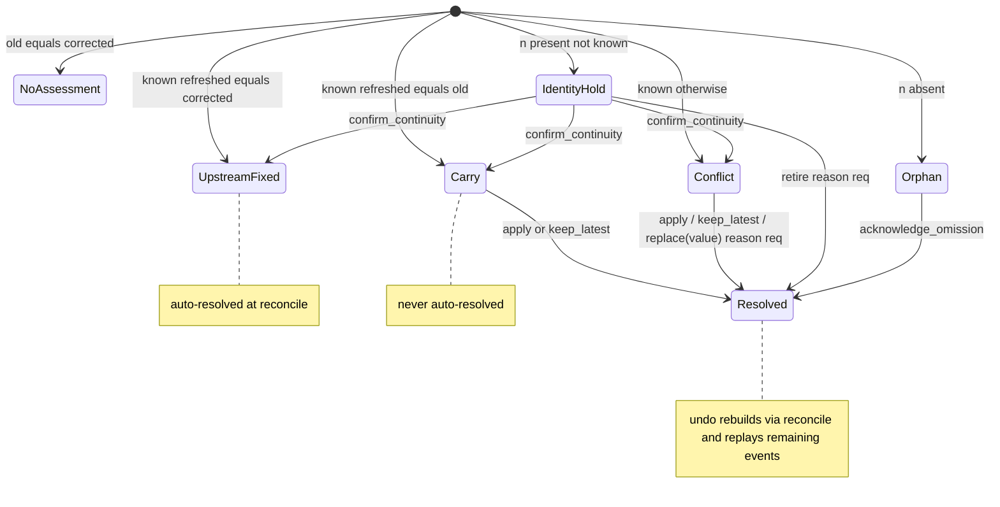

# Correction Continuity: Design

Labels match requirements.md: **Source-observed** for engine behavior, **Proposed** for the unimplemented value-rule layer. No tests were executed this session.

## Architecture (Source-observed)
- `src/engine/index.ts`: `parseCsv`/`serializeCsv` (RFC-ish, CRLF), `reconcile`, `resolve`, `undo`, `preview`, `exportReviewed`/`exportHistory`; `@noble/hashes/sha256`; deep clone via `structuredClone`; no network.
- `src/engine/recovery.ts`: `importHistory`, `saveSession`/`loadSession`/`clearSession` (key `mendline.review.v1`).
- Hashes: `contentSha256=sha256(JSON.stringify([headers,rows]))`, `rawSha256=sha256(raw bytes)`, `generationHash` over six hashes plus `policyHash`; `expectedRevision` from 0.
- Limits: 20 MB input, 100 000 rows, 1000 columns, 100 MB history, 100 000 events. Source-observed; not all unit-tested.

## Reconciliation state machine

## Binding, staleness, undo, history
- `sameBinding` compares all four binding fields; any op with a stale binding returns `STALE_BINDING` and mutates nothing.
- `undo` rebuilds from `reconcile(O,C,N,policy)` and replays remaining active events for that assessment; `confirm_continuity` undo also invalidates later same-assessment events; undo events are not undoable.
- `importHistory` requires per-event exact JSON equality (timestamp overwritten from the record), then canonical-field equality, then final-receipt equality for complete history. Tamper is rejected.

## CSV and formula
- `serializeCsv` quotes fields containing `"`, `,`, `\r`, or `\n`, doubles quotes, joins with CRLF, adds a trailing CRLF.
- Reviewed implementation update: exactly one initial UTF-8 transport BOM is consumed; a literal-leading first header is quoted on serialization. Quoted/interior/cell markers survive. Original raw bytes are retained; serialized CSV need not reproduce formatting bytes. The literal-marker defect has a focused regression in tests/engine/unicode-roundtrip.test.ts.
- Formula hold scans post-preview cells (headers, rows, untouched new rows, and user replacement values) for `^[\u0000-\u0020]*[=+@-]`; any match blocks export as `FORMULA_HOLD` and keeps history `complete=false`.

## Proposed value-rule inference (not implemented)
Scope: **non-key, non-identity corrected cell values only**, across four families: trim, case, literal, prefix. Rules are learned from example `(old, corrected)` pairs in a review. Record keys and identity fields are never transformed or normalized; key-transform/matching is out of scope.

Preview: for each candidate rule show affected `(key, column, refreshed -> proposed)` cells, the rule family, support count, and which assessments it would resolve (carry/upstream_fixed only). Preview never mutates the review.

Confirmation: a human-approved rule re-runs `reconcile` and emits the corresponding review events (e.g., `apply`/`replace`) as a revision-bumped, history-recorded batch. All existing checks (identity, formula, binding, history reconstruction) still apply unchanged.

Abstention decision table (mandatory):

| Condition | Action |
|---|---|
| column is key or identity column | abstain (out of scope) |
| examples contradict (same old -> different corrected) | abstain |
| ambiguous (multiple rules fit, or one input -> multiple outputs) | abstain |
| support below threshold (too few consistent examples) | abstain |
| target already resolved, or would mask orphan/identity_hold/conflict | abstain |
| proposed value is formula-risk | abstain (defer to FORMULA_HOLD) |
| would overwrite a value the human already set this session | abstain |
| consistent, in-scope, non-masking | preview for confirmation |

This layer is Proposed only; this spec does not implement it or generate code for it.

